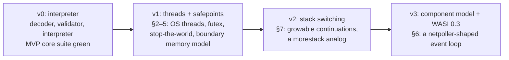

# 1. The contract came first

*Drafted 2026-10-26 from the repository's records. Corrections welcome.*

## A language-directed engine

Most WebAssembly runtimes try to treat every guest language the same way. Burroughs doesn't. Its thesis, §0 of the host contract, reads:

<!-- more -->

> Burroughs is a **language-directed engine**: a WebAssembly runtime whose host contract, fast paths, and API surface are designed to the specification of the Go runtime.

The posture is summed up in four words: **correctness-neutral, performance-partisan.** Any module that follows the spec must run correctly, and the upstream spec test suite enforces that. But where the design has to choose, it chooses for Go. The contract states the alternative plainly: *"Other guests have alternatives; that is what wasmtime is for."*

The name is the lineage. The Burroughs B5000 (1961) was a stack machine designed so that ALGOL would run best on it. Wasm is also a stack machine, and this time the favoured language is Go. The README adds that the gopher gets its burrows back, one letter askew.

## Why Go needs its own engine

The contract's non-goals (§1) rule out the obvious ambitions. It does not aim for throughput parity with optimizing compilers like Cranelift or V8, it is not for the browser, and it offers no special ergonomics to non-Go guests. The browser exclusion is pointed. The browser's constraints (a single-threaded event loop, no blocking on the main agent, Workers standing in for threads) are, in the contract's words, *"precisely the pathology this engine exists to not have."*

The contract's provenance notes explain where that conviction came from. Before Burroughs there was a port of the Go runtime to Wasm hosts that made Go no promises, and it left scar tissue. Clause T-2 (no main-thread special case) lists some of the scars:

> *the single-M assumption confessed nine-plus faces during the wasip1 port — async-m0 notes, m0-heartbeat, bell keep-alive, checkdead redrive — all scar tissue from a host where the primary agent could not block. Burroughs deletes the entire class.*

An "M" is the Go runtime's name for an OS thread. Go assumes it can have many of them, and that any of them can block in a system call while the others carry on. A host where the first thread may never block forces the runtime into workarounds, and each one becomes something to maintain.

Two more scars show up repeatedly in the contract:

- **The bell.** This was a wake mechanism in the earlier port. Clause SP-3 requires that the engine's timer machinery never write to memory that the guest's scheduler uses, and cites the bell: *"Stage-3 taught bell ≠ event queue; the D20 hunt's candidate-(ii) round taught that even suspecting bell-writes-alias-notes costs a full investigation. Burroughs makes the aliasing impossible by construction rather than absent by luck."*
- **D20, the host-wake visibility gap.** The memory model section (§4) opens with it. On the browser host, `Atomics.notify` guaranteed ordering only for the word being notified. A store to a neighbouring field could arrive after the woken agent had resumed. The guest's workaround was a bounded spin. The contract says: *"Burroughs exists so that spin is unnecessary."*

## Promises before code

The contract's preamble describes its method:

> This document is written before the engine, on purpose. Every clause below is a promise the engine must keep, and most clauses descend from a specific, named failure discovered while porting a real Go runtime onto hosts that made no such promises.

The result is a ladder of promises, each tied to a phase of the work:

A few of the promises show how directly the contract was written for Go:

| Clause | Promise | What it is in Go terms |
|---|---|---|
| T-1 | `spawn(entry, arg, stack_hint) → tid`, one OS thread per Wasm thread | *"This is `newosproc`, not a Worker with a message port."* |
| T-3 | `memory.atomic.wait`/`notify` backed by a futex, with OS-level wake latency | The runtime's own futex-based parking |
| SP-1 | Engine-native preemption: `stop(deadline)` brings every thread to a safepoint, and the guest need not instrument its own code | Stop-the-world for the GC |
| SP-2 | A thread blocked in a host call counts as being at a safepoint | *"`entersyscall`/`exitsyscall` as an engine guarantee rather than a runtime convention"* |
| B-MM-2 | A wake makes **all** of the waker's earlier writes visible, not just the futex word | The repair for D20 |
| S-1 | Growable continuation stacks | Goroutine stacks; *"the single largest Go-partisan divergence from current prototypes"* |
| M-1 | `memory.grow` costs O(pages touched): reserve up front, commit on growth | *"Go will call it; it is not an exceptional event."* |
| M-4 | WasmGC for conformance, deliberately unoptimized | *"Go brings its own collector; that is the point."* |

The contract's normative text (§§0–9) can't be edited without Scott's sign-off. Open questions in §10 are settled by decision documents, never quietly in code. That rule turns out to matter a great deal later.

## Day one

The genesis commit is dated 2026-07-30. ADR 0001 records that it was deliberately Scott's commit, signed, with the scaffold handed over uncommitted so that the history starts with Scott's own key. The scaffold had been built in a chat with chat-Claude, which *"produced the name, the positioning, and the host contract before any code."* It was then handed to CC, the implementation agent, for the build.

The first commit contained more than a stub:

- **The contract.**
- **A section-level decoder** whose error messages copy the upstream spec suite's `assert_malformed` strings verbatim, so that the suite's strings are the decoder's error contract (ADR 0003).
- **A dispatch benchmark**, `internal/interp/dispatchbench`, which measured four interpreter strategies on the same program, each with correctness checks. This was the evidence for ADR 0002's design: rewrite the bytecode into an internal form, dispatch with one big `switch`, and hold values in bare `uint64` slots with a separate array for references. The benchmark also recorded a negative result with a reproducer: closure compilation was no faster than plain in-place interpretation, and it allocated.
- **CI on x86-64 and AArch64 from the first push**, *"because a contract clause about weak memory without a weakly-ordered witness is a wish."*
- **Two graves already dug.** A "grave" here is a closed issue recording a defect and its lesson (more in post 3). Grave #2 found that the LEB128 integer decoder had merged two separate spec verdicts: *integer representation too long* and *integer too large*. Grave #3 found an error constant, `ErrLEBTooLong`, that no input could reach. The commit message gives the lesson: *"The second is why the first went unnoticed. An error constant with no reachable path is a missing check wearing a disguise."*

ADR 0002 also has a detail that shows how the project argues. chat-Claude conceded the main design question in review and strengthened the argument. The case against rewriting bytecode is startup cost on many short-lived modules, and that is *"a workload Burroughs disclaims."* Go programs compiled to Wasm are megabytes that load once and run for hours. The ADR's summary: *"The side table died on its own terms. That is the intended way for a design to die here."*

A month later, part of ADR 0002 also died on its own terms. Its claim that branch resolution would be "free" with the rewrite was measured at decode time and found to cost **+11.82%** on a corpus-shaped module. The ADR was amended rather than rewritten, with the original wording kept: *"a falsified clause read through a pointer is a record, and a rewritten one is a record with the evidence removed."* That habit of keeping the wrong sentence, marking it, and explaining it runs through the whole project.

## The first number

The same day, the `.wast` harness reported its first figure: **`binary.wast`: 49/127 pass, 78 fail, 0 unsupported.** The commit adds that failures are grouped by the spec error they expected, largest group first, *"so the suite schedules the decoder work rather than merely grading it."*

Letting the suite schedule the work became the project's first working method. The next post follows it.
