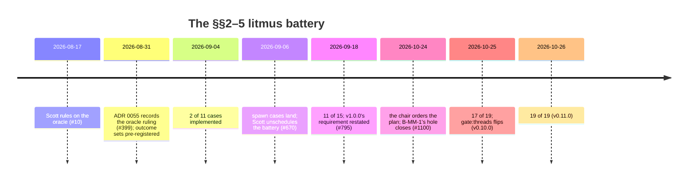

# 6. A battery that grades itself

*Drafted 2026-10-26 from the repository's records. Corrections welcome.*

## The oracle problem

In v0, every green had an outside judge. The upstream spec suite was written by people who had never heard of Burroughs, and it could disagree with the engine. That is contract §0's neutrality guarantee.

<!-- more -->

The threads contract has no such judge. Clauses like B-MM-2 (*a wake synchronizes all writes, not only the futex word*) are promises Burroughs made, and no external suite tests them. The obvious substitute, comparing against another engine, was refused on principle: §4's whole provenance is D20, the browser host that broke this exact promise. In the words of the battery's pre-registration document, *"a differential oracle would ratify the defect the contract exists to forbid."*

Scott ruled on the oracle on 2026-08-17, recorded on issue #10. It is the clearest statement of the method in the project:

> The battery's allowed-outcome sets are authored, which is new and is the hazard: a ported oracle can disagree with you, an authored one agrees with you by construction. So the allowed set for each test is derived from the contract text and written down before the implementation exists — pre-registration doing the job the reference used to do. And the external arbiter is the hardware. arm64 is weakly ordered and amd64 is TSO, and a reordering the model forbids but the machine performs will show up on one and not the other. … State once, at the top of the v1 work, that a green here means the implementation agrees with an oracle this project wrote — weaker than every green so far.

(*TSO*, total store order, is x86's relatively strict memory model. ARM's model allows more reorderings, so some bugs show up only on ARM.)

## Pre-registration

The result is `docs/litmus-battery-preregistration.md`, ADR 0055's implementation. It opens with its own warning:

> **A green from this battery means agreement with an oracle this project wrote, which is weaker than every green before it.**

A few rules make it work:

- **One entry per clause in §§2–5.** All twenty clauses get an entry, including those no test can reach, so that a clause with no case is visible rather than missing. Each quotes the contract verbatim, checked as a substring so that an amendment to the contract breaks the file instead of letting it drift.
- **Each case has Allowed and Forbidden outcome sets, a Witness, and a Floor.** The floor is the fraction of runs that must actually produce the interesting interleaving. Below it, the case *fails as un-witnessed*. Without one, a case *"cannot distinguish conforming from never raced."*
- **The PR that lands a mechanism may not edit this file.** Changing an outcome set takes its own PR stating what was wrong about the clause reading, *"because a forecast rewritten by the run it forecasts is not a forecast."*
- **Verdicts are spelled "not observed in N runs on both architectures," never "conforms."** A litmus battery is *"a falsifier, never a certificate."*

The file is data, and nothing in it runs. The one test nearby, `TestEveryClauseInSectionsTwoThroughFiveIsPreregistered`, checks the document against the contract and *"asserts nothing whatever about the engine."*

## What two architectures can and can't tell you

ADR 0004 had reserved `v1.0.0` for the threads milestone *"with the §4 litmus battery passing on both TSO and a weakly-ordered platform."* That sounds strong. Issue #795 (2026-09-18) measured what it actually meant, and found it *"satisfiable as written while misleading as read."*

| Of the 15 cases registered at the time | Count | What a pass establishes |
|---|---|---|
| Arbiter `neither`: scheduling and protocol claims | 10 | They pass identically on one platform; the second runner adds nothing |
| Judged by `-race` | 5 | Go's memory model inside the engine, not the hardware model the guest sees |
| Discriminate a hardware weak-memory outcome by value | **0** | |

The deeper finding came from the #742 recon. Each boundary crossing's acquire edge is *"inherent to the mechanism performing the crossing,"* so there is no line you can delete to open a visible reordering window while leaving the crossing working. Hardware wasn't much help either: on arm64 the forbidden outcome appeared at about 1e-5 and unreliably, *"zero in 2 of 5 trials."*

Scott approved a restatement (*"I concur and approve the recommended path"*). `v1.0.0` now requires every registered case landed or deferred with a live expiry, the battery run on both a TSO and a weakly-ordered platform (*"a portability and race-freedom requirement, which is what that run actually establishes"*), the memory-model reach stated at its measured strength wherever coverage is claimed, and a stable contract. The amendment lists what was **given up**: the reading that `v1.0.0` certifies the guest-visible memory model at the boundary on two platforms. It also lists three things that could restore it, each outside the project's reach: a second independent engine with threads, hardware that discriminates reliably, or a different instrument.

## Unscheduled, then rescheduled

The battery's schedule had its own path, covered in post 4. Scott unscheduled it on the #670 review (2026-09-06), because its only consumer was a flip condition Scott had invented. It sat at 11 of 15 cases at `v0.6.0`. The `v0.9.0` notes (2026-10-21) still list it as unscheduled.

It came back through the chair. On 2026-10-24 the chair's second ruling of the day ordered a battery plan, *"decided unless Scott objects, and nothing in it is built until Scott has seen it."* The plan set five conditions for a v1 threads claim, and the next three days went through them:

What ADR 0106 calls *"the battery's first hole"* (B-MM-1's guest-to-guest message across a host-call return) closed in #1100. With it, the battery had *"no registered hole"*: every case was implemented or deferred with a stated reason. The last two cases, SP-5 and H-4's no-starvation half, needed a component-model fixture: one async task with N threads parked in `waitable-set.wait`, plus a runner thread that counts. They landed in #1114 for `v0.11.0`, each after **10,000 `-race` iterations on darwin/arm64 and on janus x86-64 with no failure**. The smallest advance of the runner in 100ms was 29,565 on darwin and 16,443 on janus.

## How the result is stated

The `v0.10.0` claim (written with the chair, not objected to by Scott) shows the discipline at work. It sorts the cases by *what kind of evidence they are*:

- **Judged by Go's memory model via `-race`** (5 cases): *"This certifies that Burroughs' Go implementation of each edge has no data race in the schedules explored. It is not a reading of hardware ordering."*
- **Judged as scheduling claims, where both architectures must agree** (12 cases).
- **Structural, checked by controls rather than outcome tuples** (T-4, T-5, SP-3, B-MM-3/4/5, H-2, and two B-MM-1 crossings, one of which doesn't exist in this engine and one of which is v2).
- And: *"No case is judged by hardware weak-memory values (#795)."*

It also says that the stop-the-world cases (SP-1, SP-2, SP-4, SP-6) *"support no clause of this claim"*, because no public API exposes `Stop`. They are counted anyway, *"so that the counts are the battery's, not a selection from it."*

That last sentence foreshadows the correction in post 9. The battery witnesses the *engine*. Whether a user can reach that engine is a separate question, and it turned out to have a different answer.

## The weakness, named in its own words

The project could have written "threads: 19/19 green" and stopped. Instead the `v0.11.0` block says: *"The battery's strength is unchanged: Go's race detector and scheduling claims, not hardware weak-memory readings."* The battery doesn't prove the boundary memory model. It can falsify it, and in 19 cases it hasn't. The project states that limit right next to the 19/19.
