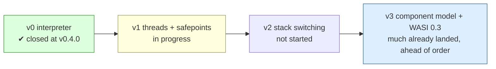

# 10. What's next

*Drafted 2026-10-26 from the repository's records. Issue states are as read on that day and will move. Corrections welcome.*

## v0.12.0: a Go program in all its glory

The next milestone, `v0.12.0 guest-started threads`, is built around #1122, which carries Scott's goal statement in its body:

<!-- more -->

> Guest started seems to be the intent of the project - Go->Wasm->Burroughs runs a Go program in all its glory on an engine that can.

Concretely: a Go program built by the Phase 4 fork runs **with real threads through the public paths** (`burroughs run`, `WASIP1Config.Run`, and the component path's `thread.spawn*` where it applies), with nothing supplied beyond the module. The target behaviour is `GOMAXPROCS > 1`, goroutines spread over several agents, and the GC working across them.

The issue also sets the order of work: *"The plan is posted here before any build, and goes to the chair."* The plan has to say what each public path refuses today, the change per path, whether the guest-side spawn import is already contract text (citing the clause, or drafting it for Scott), an end-to-end witness (a fork-built Go program with N goroutines doing real parallel work and a GC across agents, checked against an expected result through `burroughs run`), a neuter per path, and the size.

This is where the thesis is tested for real. Every earlier post describes promises made *for* Go. v0.12.0 is meant to be where a Go runtime with many Ms runs on them through a door an ordinary user can open.

As read on 2026-10-27 (UTC), the milestone holds six open issues: #1122; #1128 and #1129, two component-path defects (the CLI's handling of `run <component>` flags, and a mistyped `Component.Call` argument's error class); #1132 and #1133, two T-5 gaps; and #406, the Go-runtime torture set.

One question is explicitly *not* being reopened. SP-1's "reading (b)", stopping a Go guest without relying on its compiler-inserted loop checks, stays parked (#1064). The issue states that *"the engine's existing loop-check preemption covers the Go guest."*

## The rest of the ladder

The ladder no longer reads strictly left to right. The component model and WASI 0.3 async, nominally v3, landed in September and early October, behind gates that were then flipped, while v1 was still open. The component work numbers its own phases (Phase 2 components, Phase 3 async, Phase 4 the Go fork), separate from the v0–v3 ladder, and the `v0.6.0` notes state how they relate: *"phases 2–3 are the product, the fork is the thesis."* v2 (contract §7, growable continuation stacks) hasn't started. The roadmap reading of 2026-10-18 (#1046, a snapshot taken from the tracker and tree that *"replaces anyone's recollection of the roadmap"*) records that `binary.Features` *"has no stack-switching field"* and that the v2 milestone holds one issue, the §10.5 continuation-walk interface (#14).

## Contract clauses with no implementation yet

The same roadmap reading lists contract promises nobody has built. Each is tracked; the reading recorded #1047, #1048 and #1049 as parked. States below are as read on 2026-10-27 (UTC):

| Clause | Promise | State (issue) |
|---|---|---|
| §3 SP-3 | A deadline/timer wake facility, its channel disjoint from guest sync state (the clause the bell wrote) | no implementation (#1047, milestone `unscheduled`) |
| §6 R-1 | A batch readiness API, `poll_ready`, the netpoller analog | no occurrence in the tree (#1048, now on milestone `v0.14.0 (proposed) WASI 0.3`) |
| §8 M-2 | A decommit hook, so a guest's RSS isn't a ratchet | no implementation (#1049, milestone `unscheduled`) |
| §7 S-1–S-4 | Growable continuations, a native switch, a walkable stack set | not started (v2; #14) |
| §2 T-5.2 | A *host-side* join an embedder can call | exists only on the internal `interp.Instance` (#657) |
| §5 H-3 | A guest-visible cancel for blocked host calls | open (#13, v1 milestone); Scott's recorded lean is *"v1 minimal — shutdown-interruptibility is the MUST"* |

Six core proposals also remain **default-off**: exception handling, memory64, GC, tail calls, multi-memory and extended constants. Together they account for the board's 4187 gated vectors. Their per-gate forecasts were just posted for Scott's stamp (post 9). The contract's M-4 says GC is implemented *"for conformance … and deliberately unoptimized. Go brings its own collector."*

## The distance to v1.0.0

`v1.0.0` is reserved for the v1 threads-and-safepoints milestone landing, and ADR 0004's amendment (approved by Scott on #795) sets four conditions on that landing. The v1 milestone itself still has four open issues as read on 2026-10-27 (UTC): #13, #514, #515 and #542.

1. **Every registered §4 litmus case landed or deferred with a live expiry.** Met at `v0.11.0`: 19 of 19, with no deferral left.
2. **The battery run on both a TSO and a weakly-ordered platform.** CI gates on linux x86-64, linux arm64 and darwin arm64.
3. **The memory-model reach stated at its measured strength** wherever the version's coverage is claimed. The `v0.10.0`/`v0.11.0` claim texts are written that way. Whether a claim about *public* threads can be stated at all depends on v0.12.0.
4. **The contract stable** (§1 non-goal 4). It is still v0.1, with amendments that each name what forced them.

A recon filed on 2026-10-26, #1126, examines *"a hardware weak-memory reading for the §4 battery"* and *"what it could establish,"* and raises a wasmtime core-threads option that the earlier #742 recon *"did not weigh."* It is explicit that this would not restore what #795 gave up: the wasmtime option could corroborate the battery's registrations for the guest→guest cases, not certify Burroughs, and *"Nothing here reopens #795."*
## Open questions

Several things are unresolved, and the tracker says so:

- **Whether to report wasmtime's bug upstream** (#1045) is Scott's call, and the fixture is ready.
- **ADR 0102**, the pin-versus-toolchain rule, is still `proposed`, waiting on a stamp.
- **Windows** is compiled, run as a measurement, and outside every claim. Scott's 2026-10-10 ruling made it unsupported.
- **A Go runtime fatal seen once on CI's arm64 runner** (#1089) has not repeated, and is carried as a known limit rather than treated as resolved.

## A closing note on method

This series could be written only because the project's records are good enough to write history from. Nearly every sentence here traces to a commit message, an ADR's `Status:` line, a release block's "known limits," or an issue's closing comment. The same records explain the project's habit of correcting itself in public: the `v0.4.0` note that said *"it is not v1"* and was superseded, ADR 0002's falsified "free," the `v0.10.0` threads claim that `v0.11.0` corrected the next day.

The B5000 favored ALGOL by building the machine around it. Burroughs is trying to favour Go by building the *promises* around it first, and then checking, more carefully than most projects do, whether each promise is actually kept.
