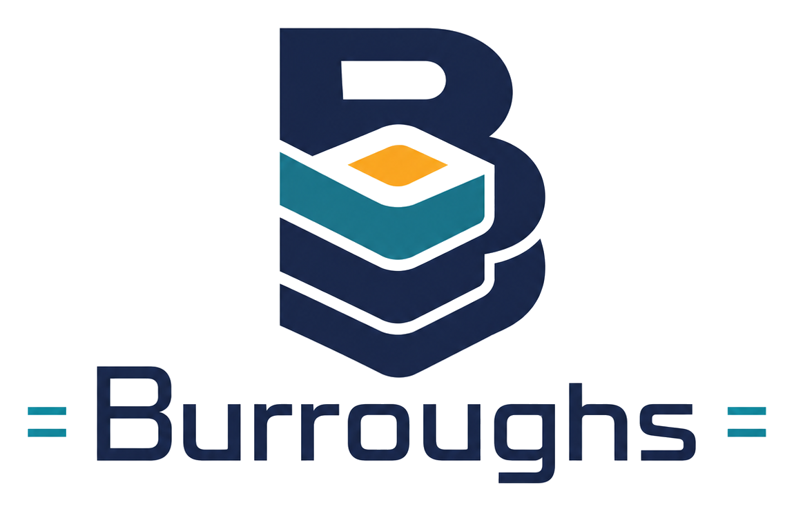

<h1 class="bx-wordmark"></h1>

Go &rarr; Wasm &rarr; Burroughs

<strong>A WebAssembly runtime written in pure Go, designed around one guest language: Go.</strong>
Correctness-neutral, performance-partisan. The B5000 favored ALGOL. Burroughs favors Go.

[Read the docs](docs/index.md){ .md-button .md-button--primary }
[Read the blog](blog/index.md){ .md-button }
[GitHub](https://github.com/scttfrdmn/burroughs){ .md-button }

## What it is

- **Pure Go.** No cgo, and no dependency outside the Go standard library. The module is
  `github.com/scttfrdmn/burroughs`, and Burroughs is a library first: its CLI's `burroughs run` goes through the same
  public API and nothing else.
- **Go-partisan, correctness-neutral.** Burroughs' host contract (threads, preemption, the memory model at host
  boundaries, stacks, the WASI 0.3 event loop) is written around what the Go runtime needs from a host. Any guest
  that conforms to the spec should run correctly, and the upstream WebAssembly spec test suite is how that is
  checked. Where a design tradeoff exists, the choice that favours Go wins, in API surface and optimization
  priorities, never in correctness.
- **An interpreter.** The pipeline is decoder, internal form, validator, interpreter. There is no compiler, and none
  is on the roadmap.
- **A research engine first.** Production hardening against hostile modules is a stated non-goal of the current
  contract (v0.1).

The name comes from the Burroughs Large Systems (the B5000, 1961), stack machines designed so that one high-level
language would run best on them. Wasm is a stack machine too.

## What works today, in plain terms

As of `v0.12.0` (the release quoted below, when this page was written):

- **Core WebAssembly** (the MVP and Wasm 2.0 features, plus SIMD, relaxed SIMD, and four Wasm 3.0 proposals:
  extended constant expressions, tail calls, multi-memory and memory64) runs, from Go (`burroughs.Instantiate`) or
  from the command line (`burroughs run`). The spec suite's core board reports no failures.
- **Go programs built with `GOOS=wasip1 GOARCH=wasm`** run through `WASIP1Config.Run` or `burroughs run`, with
  arguments, an environment, the standard streams, and read-only or writable directory grants.
- **A WASI preview-1 guest can start its own threads.** A module that imports `"burroughs" "spawn"` and exports
  `mstart` starts agents on OS threads over its shared memory, through those same two paths. That is the door the
  Phase 4 Go fork uses, so a fork-built Go program runs with real threads. Core `Instantiate` supplies no imports,
  so it still starts no second thread, and host-started threads are not built.
- **Components** load, and their typed exports can be called from Go with `u32`, `string`, `list` and `record`
  values. The async component ABI, cancellation through `context`, and `wasi:cli/run` worlds work.
- **Not yet:** stack switching, a full WASI 0.3 host, and two proposals that stay gated off (GC and exception
  handling). Linux and macOS (64-bit) are built and tested; Windows runs the tests in a separate CI workflow as a
  measurement, not a gate, and is unsupported.

The [known limits page](docs/limits-and-status.md) has the details, with issue numbers.

--8<-- "generated/release.md"

## Where to go next

- **[Docs](docs/index.md)**: install, the CLI, the Go API, four tutorials, concepts, limits and the roadmap. Every
  example program on those pages is run by this site's CI against the latest Burroughs release.
- **[Blog](blog/index.md)**: *Building Burroughs*, a ten-part story of how the engine and its unusual process were
  built, from an empty repository to `v0.11.0`.
- **[GitHub](https://github.com/scttfrdmn/burroughs)**: the code, the `CHANGELOG.md`, the decision records, and the
  issue tracker, where the project's status lives.

Burroughs is licensed under Apache 2.0, &copy; 2026 Scott Friedman.
